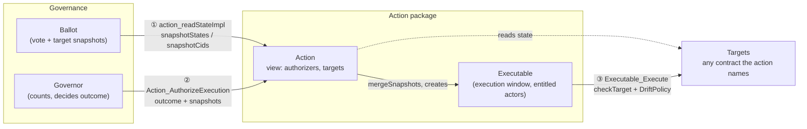

<!-- SPDX-License-Identifier: Apache-2.0 -->

# cap-governance rationale

This file explains the design decisions in cap-governance.

## Goal

The goal of cap-governance is to reduce the time it takes to build a governance
app on Canton. It provides the parts every governance app needs. Each part is
described below with the reason it is needed.

### Fetching and grouping ballots by proposal

A mechanism must count only the ballots of the proposal it resolves, and each
ballot only once. The resolving party chooses which ballots to present, so the
choice that runs the mechanism must refuse a ballot from another proposal and a
ballot presented twice. `fetchGroup` fetches the ballots, refuses duplicates and
checks that each ballot references the same `ResolutionRef`. `requireResolvedBy`
checks that the resolution ref names the governor where the outcome is decided
and the mechanism used.

**Example:** a decentralized party has two open proposals on the same governor.
Without the group check, the party resolving proposal A could present ballots
cast on proposal B. It could also list one ballot twice to double its votes.

### Checking the identity of the contracts a decision acts on

A target is a contract the execution needs to read or act on. An action names
each target by an `AuthenticKey`, which is the set of signatories plus an id. A
contract id by itself cannot prove who signed the contract. Any party can create
a contract of the same template with the same fields. `fetchCheckedAny` fetches
the presented contract and compares the key it computes from its own
signatories with the key the action names. `fetchVotingRights` does the same check
for the contracts that carry voting rights.

**Example:** a proposal changes a parameter on a contract A signed by the operator.
An attacker creates a contract B of the same template, signed only by
themselves, and presents it as the target. Without the identity check, the
execution acts on the attacker's copy and contract A never changes, even though
the proposal counts as executed. The same risk applies to voting rights: a
self-signed voting-right contract would give its creator voting power they
don't have.

### Admitting votes

A vote counts only if its voter has the right to vote, has not voted already,
and voted for something the mechanism counts. `weightedCastsOf` and
`castsOf` refuse:

- a voter who appears on two ballots;
- a voter with no weight;
- a negative weight;
- a vote that the mechanism's `voteOf` does not accept.

**Example:** a ballot template carries votes of type `Approve | Reject | SetFee
Decimal`, and a yes/no mechanism counts only `Approve` and `Reject`. 

### Quorums and tallies

Every governance app decides two things: whether enough voters took part
(`Quorum`), and what the votes concluded (`Tally`). `decide` combines them into a
`Verdict`: `Lapsed` when the quorum fails, `Undecided` when the tally reaches
nothing, and `Decided` otherwise. They are kept separate because low turnout
and a split vote are different outcomes, and an app may handle them
differently. `Cap.Governance.Utils.Count` provides common quorums
(`atLeastPresent`, `atLeastVotes`, `atLeastVotedWeight`, `atLeastShareOfTotal`)
and tallies (`unanimous`, `plurality`, `shareOfVotes`, `median`,
`weightedMedian`), so an app builds its rule from these parts.

`Casts` holds one cast per eligible voter. Each cast's `vote` is `Absent`
when no vote was presented for the voter, `Abstained` when the voter took part
without choosing an option, or `Voted` with the option. Quorums can count
abstentions as turnout, and tallies only see `Voted`, because an abstention is
part of the turnout but not of the result.

**Example:** `decide (atLeastShareOfTotal 1 2) (shareOfVotes 2 3)` requires the
voters present, abstentions included, to hold half of the eligible voters' weight, and
one option to get at least two thirds of the weight of the votes. Shares are
given as a numerator and a denominator so that a share like two thirds is exact.

### Taking a snapshot of a target and checking it again at execution

A target can change between the vote and the execution, and voters approved the
change against the state they saw. A `Snapshot` records, per target, the state
or contract id the decision was made against. An action declares its `targets`
when it is created and can fix parts of their snapshots then. `snapshotStates`
and `snapshotCids` fill the parts the action left open with the target's current
state or contract id, and `mergeSnapshots` merges those snapshots into the
action's targets. At execution, `checkTarget` compares the target's live state
with the snapshot state using the action's
`DriftPolicy`. It refuses the execution if the target changed in a way the
policy does not allow.

**Example:** a target's fee is 1%, and voters approve proposal A to raise it to 2%.
Before A executes, proposal B raises the fee to 3%. If A then executes, it
lowers the fee from 3% to 2%, which nobody voted for. With a snapshot of the fee at 1%
and the `unchanged` policy, `checkTarget` sees that the fee is now 3% and
refuses A.

Other policies allow some changes. Take the same target with a fee of 1% and a
withdrawal limit of 10,000, and proposal A that raises the fee to 2%. The drift
policy `sameOn (.fee)` requires only the fee to be unchanged. If proposal B
lowers the withdrawal limit to 5,000, A still executes, because the fee is
still 1%. A drift policy only decides whether the execution goes ahead. To keep
B's change, A's execution must write only the fields A changes, for example
with Splice's `patch`, which applies the fields that differ between the new and
the snapshot state to the live state.

## When CAP uses an interface

CAP defines an interface only where we expect code to work with a contract
whose template it cannot know when it is compiled. Elsewhere it uses templates,
type classes and helper functions.

### Action and Executable

`Action` and `Executable` separate a governance app from the contracts it
changes. Through them, a decentralized party can govern contracts in other
packages or owned by other parties, without its package depending on theirs,
and one action contract can be used by several governance mechanisms.

`Action` is an interface because a governor calls it on contracts written by
someone else. The owner of a target signs an action that names the
decentralized party in `authorizers`, and the governor's choice that runs the
mechanism exercises `Action_AuthorizeExecution` on it. That choice is written without
knowing the action's package. The action's signatories don't have to be the
governor's signatories, so a target owner can delegate authority over it to a
decentralized party.

`Executable` is an interface because it is what that call returns, and an
executor app can execute it without knowing the action's package.

The diagram shows how a governance app uses an action and its targets. The
governance app never reads or changes a target directly. It reads targets
through the action, and it holds their state only as `Snapshot`s.

1. When a ballot is cast or a proposal is resolved, the governance app reads the
   targets through `action_readStateImpl`, using `snapshotStates` or
   `snapshotCids`. The result is a `Snapshot` per target.
2. The governor's choice that runs the mechanism exercises `Action_AuthorizeExecution` with the
   `outcome` (vote aggregation) and the snapshots. The action merges them into its own targets
   using `mergeSnapshots` and creates an `Executable`.
3. An entitled actor exercises `Executable_Execute` and presents the target
   contracts (`targetCids`). `checkTarget` compares each target's live state with its snapshot using
   the action's `DriftPolicy`, and the action then changes the targets.

### Ballots

A `Ballot` interface would let a governor count ballots of templates it does not
know at compile time. That would allow:

- ballots from a template written by another party, such as a wallet, to be
  counted by several governors;
- generic tools, such as indexers and UIs, to read ballots across apps.

It would also have these costs:

- The interface's package is frozen, so every ballot has to fit one view. A
  shared ballot, a per-voter confirmation and a sealed vote have different
  shapes, and fields outside the view are not reachable through the interface.
- A choice taking `ContractId Ballot` accepts any template that implements
  the interface. A vote is only as trustworthy as the template that created it,
  because the template's signatories, `ensure` clause and cast choice decide who
  can vote and for what. A governor that accepts the interface has to decide
  which templates it trusts.

`IsBallot` in `Cap.Governance.Utils.Ballots` lets the library work with any
ballot template without an interface. It gives the library a ballot's casts,
its snapshots, the action it asks to authorize, and how to consume it. An app writes
one instance per ballot template.

We chose not to define a `Ballot` interface because we think the common case is
a governor counting ballots of templates written for it.

### Governor

A governor interface would let a client or another contract trigger a
resolution on a governor whose template it does not know. The removed
`Resolver`, `Governor` and `Submittable` interfaces provided this through:

- a generic entry point, `Resolver_Resolve`;
- a `procedures` map, looked up by name;
- `Submittable`, which carried a `ResolutionRef` (then named `Mechanism`) to
  that entry point.

That would allow, without depending on the called governor's package:

- one client to resolve proposals on governors from different apps;
- one governor to call a resolution on another governor, for example a
  decentralized party delegating a decision to a sub-group's governor.

It would also have these costs:

- A generic entry point takes the presented contracts and `extraArgs` in a
  generic form. A client still has to know the governor's format to build them,
  so the entry point is generic only in its signature.
- Mechanisms are found by a `Text` name instead of being typed choices, so a
  wrong name or wrong arguments fail at run time.
- The interface's package is frozen, so every governor's resolution has to fit
  one signature.

Without an interface, each mechanism is a named choice on the governor, with
typed arguments. The cost is that a client or contract that resolves proposals
has to depend on the governor's package.

We chose not to define a governor interface because we think the common case is
a resolution submitted by a client written for that governor.
