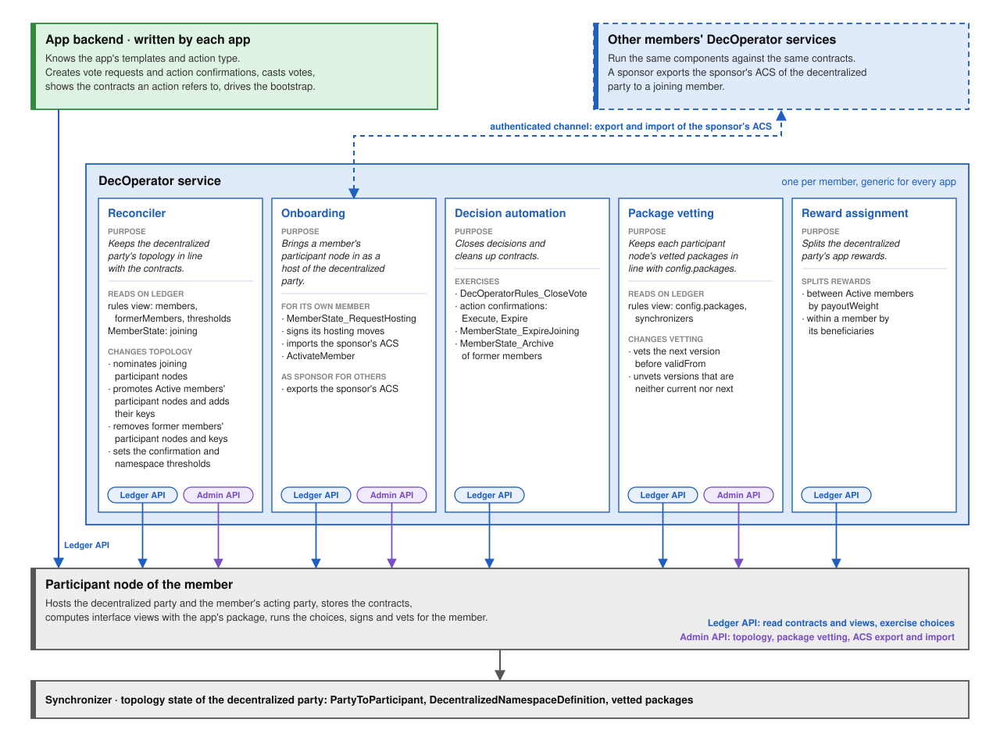

# Off-ledger components

The software that each member of a decentralized operator runs next to its participant node

A **decentralized operator** is a set of members that operate one decentralized party (**decparty**) together. Its rules are contracts on the ledger, described in [ON-LEDGER.md](ON-LEDGER.md). Members decide changes to the decparty's topology on the ledger. Each member's DecOperator service changes the topology to match what the contracts record.

## The decparty

### Participant nodes and topology

A **participant node** stores the contracts of the parties it hosts and confirms the transactions that need their approval. A single organization operates it. A decparty is a party hosted on several participant nodes.

Who hosts and who owns a party is recorded in **topology transactions**, separately on each synchronizer. A participant node submits a topology transaction to a sequencer of the synchronizer. The sequencer orders it and delivers it to every participant node, sequencer and mediator on that synchronizer. Each of these nodes validates the transaction and stores it in its own topology store for the synchronizer. Every node therefore holds the same topology state. The mediator reads it to know which participant nodes must confirm a transaction.

The decparty's topology state consists of these mappings:

| Topology mapping | Holds | Threshold |
| --- | --- | --- |
| `PartyToParticipant` | The participant nodes that host the decparty, each with a permission: Submission, Confirmation or Observation | **Confirmation threshold:** the number of hosts that must confirm each transaction of the decparty |
| `DecentralizedNamespaceDefinition` | The **namespace owners**: the namespace keys that own the decparty's namespace | **Namespace threshold:** the number of namespace owners that must sign each topology change for the decparty |
| Vetted packages | The packages a participant node accepts in transactions | None. Each participant node vets its own packages. |

Any group of hosts that meets the confirmation threshold can approve any transaction for the decparty. A decparty is therefore only as protected as its lower threshold ([Decentralization](https://docs.canton.network/overview/reference/decentralization)).

A participant node exposes two APIs:

- **Ledger API.** Reads contracts and exercises choices as a party. The participant checks the user's `actAs` and `readAs` rights, and Daml authorization decides whether each choice succeeds. The participant node signs the transactions it submits and its confirmations with its **protocol signing key**.
- **Admin API.** Signs topology transactions, vets packages, and exports and imports contracts. These operations act on the participant node itself. The participant node does not check them against any contract. It signs topology transactions with its **namespace key**. For a decparty, each namespace owner's key counts toward the namespace threshold.

### The problem

A decparty can only submit transactions if a threshold of its members agree. The solution is having the decparty act instead through a Daml contract it signs: the members' acting parties control the choices, and the **rules contract** counts how many of them must agree ([Decentralization](https://docs.canton.network/overview/reference/decentralization)).

The set of members exists in three places:

- **The rules contract:** the members, who vote.
- **`PartyToParticipant`:** the hosts, which confirm the decparty's transactions.
- **`DecentralizedNamespaceDefinition`:** the namespace owners, which sign the decparty's topology changes.

A vote that admits or removes a member is not enough to change the topology. The nodes on the synchronizer only apply a topology change when enough namespace owners sign it. 
Another component must carry out the operational work that the decparty's contracts depend on, at least:

- Copy the decparty's contracts to a new host before it confirms.
- Syncronize vetted packages between hosts.
- Exercise the choices that close a vote / execute an action.
- Split the decparty's app rewards between the members.

Each member's DecOperator service carries out this work, from what the contracts record.

## Overall structure

Each member runs two components next to its participant node. On Canton Network, this participant node is part of the member's validator node.

| Component | Written by | Knows the app's templates | APIs | Role |
| --- | --- | --- | --- | --- |
| **App backend** | Each app | Yes | Ledger API | Carries the members' decisions to the ledger: vote requests, votes, action confirmations |
| **DecOperator service** | This library, once for every app | No. It reads the contracts through the interfaces in `dec-operator-interfaces-v1`. | Ledger API and Admin API | Carries out what the contracts require: topology, onboarding, closing decisions, package vetting, rewards |

The split follows from Daml. A vote request and an action confirmation hold a value of the app's action type, and a Daml interface cannot be generic over that type. Only the app's code can create them. Everything else the service needs is in the interface views, so one implementation serves every app.

## App backend

The app backend is how members put decisions on the ledger. It is the app's own software and UI, and the app developer writes it together with the app's Daml package.

| Task | What it is for |
| --- | --- |
| **Request a vote** | Puts a decision to the members: a library action such as `DOA_AddMember` or `DOA_SetConfig`, or an app action. It exercises the app's request-vote choice, which creates a shared vote record. |
| **Cast a vote** | Records the member's vote with `DecOperatorRules_CastVote`, encoded for the record's mechanism |
| **Confirm an action** | Records that the member's backend computed the same automated action from ledger state. |
| **Show what a vote changes** | Displays the contracts an action refers to. The `SharedVoteRecord` view holds only the rendered options. |
| **Bootstrap** | Creates and signs the `FoundingAgreement`, which records the founders' consent to the first members and configuration |
| **Run the app** | Everything specific to the app, such as registrations or transfers |

Every app that uses the library writes this component. The DecOperator service cannot replace it, because actions are specific to each app buissness logic.

# From here on its just design decisions (needs feedback)

## DecOperator service

The DecOperator service has (at least) five tasks. One service per participant node serves every decentralized operator whose decparty that node hosts. It stores no contracts and holds no keys: it signs through its participant node. Before it uses a view, it checks two things: the view's `governance` key names a decparty that signs the contract, and its participant node hosts that decparty. It requires exactly one rules contract per governance key. With two, it stops acting for that decparty and raises an alert.

### Reconciler

The reconciler makes the topology of the decparty follow the members in the rules contract. Without it, a vote that admits or removes a member changes the rules contract only, and each operator must sign the matching topology change by hand.

Each member's reconciler reads the same contracts and computes the same target topology. It signs one change at a time, with an explicit serial, so that every reconciler signs an identical proposal. The nodes on the synchronizer apply the change once the namespace threshold is met.

#### How a topology change could be applied

The services do not send each other messages to change topology. Each one reads the ledger and signs through its own participant node, and the synchronizer collects the signatures. For example, after a vote removes member C:

1. **The ledger delivers the decision.** The vote creates a new rules contract without C. Each host of the decparty stores it, and each member's service reads it from its own participant node through the Ledger API.
2. **Each service computes the same change.** It reads the current `PartyToParticipant` mapping and its serial through the Admin API. The target is the same mapping without C's participant node, with serial + 1.
3. **Each service asks its participant node to sign.** It calls `TopologyManagerWriteService.Authorize` on the Admin API with the target mapping and serial. The participant node signs with its namespace key, one of the namespace owners and sends the signed topology transaction to the synchronizer.
4. **The synchronizer collects the signatures.** The sequencer orders each submission and delivers it to every node on the synchronizer. Each node merges the signatures of identical topology transactions. Below the namespace threshold, the transaction stays a **proposal** and has no effect.
5. **The change takes effect.** When the namespace threshold of signatures is reached, the transaction is fully authorized. It takes effect after the synchronizer's topology change delay. Other proposals with the same serial can then never take effect.
6. **The reconcilers move to the next change.** Each service sees the new mapping through the Admin API and computes the next step, such as removing C's key from `DecentralizedNamespaceDefinition`.

Signatures merge only if the topology transactions are identical: the same mapping, serial and operation. A reconciler that computes a different target creates a competing proposal with the same serial, which stays a proposal unless enough namespace owners sign it.

Four changes also need the signature of the participant node or key that they add: adding a participant node above Nominated, raising its permission, moving its hosting state forward, and adding a namespace owner. The nodes on the synchronizer reject them without it ([`topology.proto`](https://github.com/digital-asset/canton/blob/main/community/base/src/main/protobuf/com/digitalasset/canton/protocol/v31/topology.proto)). The joining member's own reconciler signs these changes, so a participant node never becomes a host or a namespace owner without its operator's service agreeing.

| Member | Its participant node in `PartyToParticipant` | Its namespace key |
| --- | --- | --- |
| Admitted, not joining | Not listed | Not a namespace owner |
| Admitted, joining | Observation permission | Not a namespace owner |
| Active | Confirmation permission | Namespace owner |
| Former | Not listed | Not a namespace owner |

The reconciler gives the decparty these properties:

- **A participant node confirms only after its member is Active.** Observation permission lets a joining node receive transactions without confirming them. A participant node can move its own hosting state forward without signatures from the decparty's namespace owners, so the permission, not the hosting state, keeps a joining node from confirming.
- **Thresholds follow membership.** Members vote on fractions. The reconciler multiplies each fraction by the count of Active members and rounds up. It raises the confirmation threshold in the same topology transaction that promotes a participant node. It removes a former member's participant node before it lowers the threshold.
- **Removal is complete.** A removal vote removes the member's participant node from `PartyToParticipant` and its key from `DecentralizedNamespaceDefinition`.

The reconciler runs when a rules contract or `MemberState` is created, and every 30 seconds. A namespace owner whose service stops signs nothing, so topology changes need the running services of enough namespace owners to meet the namespace threshold.

Splice equivalent: `SvNamespaceMembershipTrigger`, `SvOnboardingPartyToParticipantProposalTrigger`, `SvOffboardingPartyToParticipantProposalTrigger` and `SvClearOnboardingFlagTrigger`.

### Onboarding

Onboarding makes a new member's participant node a host of the decparty. A participant node must hold the decparty's active contracts before it can validate the decparty's transactions. The operators copy them with party replication, a manual procedure on the Admin APIs of an existing host and the new host. The new host disconnects from the synchronizer, imports the contracts that an existing host exported, and reconnects ([Party replication](https://docs.canton.network/global-synchronizer/production-operations/party-management)). Onboarding runs these steps from the contracts.

For its own member, onboarding:

1. Requests hosting with `MemberState_RequestHosting`, once the participant node is ready to import contracts.
2. Imports the decparty's contracts from a **sponsor**, which is any Active member, after the reconcilers nominate the participant node.
3. Activates the member with `DecOperatorRules_ActivateMember` once the participant node's hosting state is Active.

As a sponsor, the service exports the contracts to a joining member. It accepts only a channel authenticated with the `publicKey` in that member's `MemberState.service`, and only while that member is joining. A new host depends on the integrity of the sponsor's export, as in any party replication.

Splice equivalent: the sponsor's party migration endpoint in SV onboarding.

### Decision automation

Decision automation exercises the choices that end a decision or clean up after one. Each of these choices needs a controller, and without automation a decision that has passed waits until a member exercises it.

| Choice | Ends |
| --- | --- |
| `DecOperatorRules_CloseVote` | A shared vote record whose result is decided, or whose `voteBefore` has passed |
| `ActionConfirmationRules_Execute` | An automated action that enough Active members confirmed |
| `ActionConfirmationRules_Expire` | An action confirmation past its `expiresAt` |
| `MemberState_ExpireJoining` | A hosting request older than `onboardingTimeout` |
| `MemberState_Archive` | The `MemberState` of a former member |

Decision automation adds no authority. Each choice checks the contracts and fails when it is exercised too early. Any member's service can exercise it. When several services exercise the same choice, one transaction commits and the others fail, so each service waits a random delay first.

Splice equivalent: `CloseVoteRequestTrigger` and `ExecuteConfirmedActionTrigger`.

### Package vetting

Package vetting keeps the packages that every host accepts equal to `config.packages` in the rules contract. A transaction fails if it uses a package that a participant node hosting one of its stakeholders has not vetted. Hosts that vet different versions of the app's packages therefore fail the decparty's transactions.

Members change a package version by vote, with a `validFrom` time. Each service vets the next version as soon as it appears in the rules contract, so that every host accepts it before `validFrom`. It unvets versions that are neither current nor next. It does this on every synchronizer in the rules contract's `synchronizers` map.

Vetting changes only the member's own participant node, so no threshold applies. A member whose service stops does not vet new versions, so transactions that use them fail once they become current.

Splice equivalent: `SvPackageVettingTrigger`.

### Reward assignment

Reward assignment pays the decparty's app rewards to the members. The rewards accrue to the decparty, which cannot submit commands, so a member's service exercises the reward choices.

The split has two levels:

- **Between members:** by `payoutWeight` in the rules contract, over the Active members.
- **Within a member:** by the `beneficiaries` in its `MemberState`, which the member sets without a vote.

The service reads the split from the contracts at each payout. A membership change or a new payout weight therefore applies to the next payout, without a separate vote on the split.

Splice equivalent: `ReceiveSvRewardCouponTrigger`.
