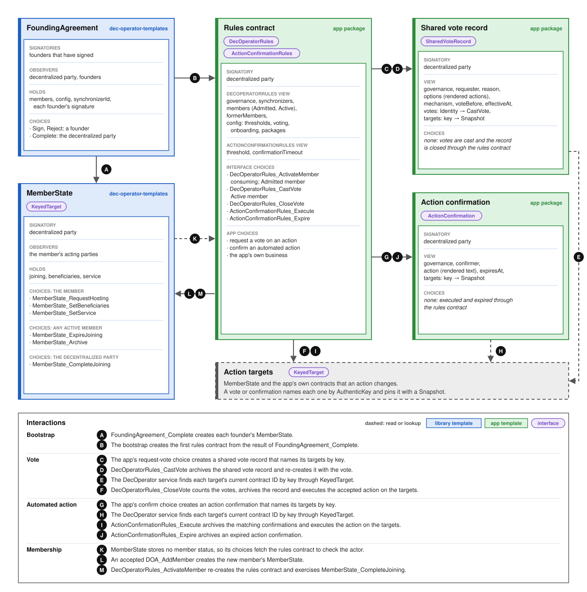

# On-ledger architecture

A decentralized operator is a set of members that operate one decentralized party together, as the Super Validators operate the DSO party. Its on-ledger state is split across two Daml packages from this library and one package that each app writes. The DecOperator service and other clients read every app's contracts through the three dec-operator interfaces, `VoteRecord` from `cap-governance-vote-v1` and `KeyedTarget` from `cap-governance-execution-v1`, without the app's code. The off-ledger side is in [OFF-LEDGER.md](OFF-LEDGER.md).

No app template implements the interfaces yet. The rules contract, shared vote record and action confirmation below are the design that an app follows.

## Packages

| Package | Path | Contains | Written by |
| --- | --- | --- | --- |
| `dec-operator-interfaces-v1` | `dec-operator/interfaces` | The three interfaces and the shared types (`Cap.DecOperator.Types`). `VoteRecord`, `Vote`, `Reason`, `ActionId` and `KeyedTarget` come from `cap-governance-vote-v1` and `cap-governance-execution-v1`. | This library |
| `dec-operator-templates` | `dec-operator/templates` | `FoundingAgreement`, `MemberState` and the checks in `Cap.DecOperator.Templates.Rules` | This library |
| App package | The app's repository | The rules contract, the shared vote record, the action confirmation and the app's own contracts | Each app |

A package that defines interfaces cannot be upgraded, so the types in `dec-operator-interfaces-v1` never change. New settings go in `DecOperatorConfig.meta`. Anything else needs a new version of the interface package.

The app writes its own templates for the three green contracts, because each holds a value of the app's action type. A Daml interface cannot be generic over that type.

## Parties

- **Decentralized party.** The party that the members operate. It signs the rules contract, every `MemberState`, and the app's shared vote records and action confirmations. It is the only party in `governance.authorities`.
- **Acting parties.** The parties that vote and act for a member. Each member is keyed by an `Identity` and lists its acting parties in the rules contract, so a member keeps its votes when its acting parties change. A `PartyIdentity` member also acts as its own party.
- **Participant node.** Each member has a participant node (`participantNode.participantId`) and a namespace key. The Active members' participant nodes are the confirming hosts of the decentralized party, and their keys are the owners of its decentralized namespace.

Every interface choice takes an `actor` that controls it. The choice runs with the authority of the decentralized party, because that party signs the contract. The implementation then checks that the actor is an acting party of a member with the required status.

## Governance key

Every contract carries `governance : AuthenticKey`. Its `authorities` is the set holding the decentralized party. Its `id` distinguishes decentralized operators that share one decentralized party. `fetchRulesView` rejects a rules contract whose `governance` differs from the caller's, or that the authorities do not sign.

## Contracts

### Rules contract

The app's template that implements `DecOperatorRules` and, if the app has automated actions, `ActionConfirmationRules`. There is exactly one active rules contract per governance key. The DecOperator service stops acting for a decentralized party with two.

The `DecOperatorRules` view holds:

| Field | Content |
| --- | --- |
| `governance` | The governance key |
| `synchronizers` | Logical synchronizer ID to `SS_Joining`, `SS_Active` or `SS_Leaving`. The reconcilers keep the party's topology in line on each one. |
| `members` | `Identity` to `Member`: acting parties, participant node, status (`Admitted` or `Active`) and `payoutWeight` |
| `formerMembers` | The acting parties and participant node of each removed member. Admission rejects them while `enableReadmission` is off. |
| `config` | `thresholds` (vote, confirmation, namespace), `voting`, `onboarding`, `maxTextLength`, `packages`, `meta` |

Each threshold is a `Fraction` of the Active members, rounded up. Admitted members do not vote and do not count. The library rejects a configuration unless every fraction is at most 1, `vote` is above 1/2, and `confirmation` and `namespace` are at least `vote`. The default is 2/3 for all three.

`DecOperatorRules` choices:

| Choice | Consuming | Controller | Effect |
| --- | --- | --- | --- |
| `DecOperatorRules_ActivateMember` | Yes | An acting party of an Admitted member | Re-creates the rules contract with the member Active and exercises `MemberState_CompleteJoining`. The member's DecOperator service calls it once its participant node is Active in topology. |
| `DecOperatorRules_CastVote` | No | An acting party of an Active member | Archives and re-creates the shared vote record with the vote. `Abstained` abstains, and `Absent` withdraws the member's vote. |
| `DecOperatorRules_CloseVote` | No | Any actor | Counts the Active members' votes, fails while the result is pending, archives the shared vote record, and executes an accepted action now or at `effectiveAt`. Returns `VO_Accepted`, `VO_Rejected` or `VO_Expired`. |

`CastVote` and `CloseVote` are nonconsuming, so a vote does not re-create the rules contract. `CloseVote` passes the rules contract ID to the implementation, so an accepted action such as `DOA_SetConfig` can exercise a consuming choice on it.

The app's action type should include the variants of `DecOperatorAction`, which the library executes:

| Action | Effect |
| --- | --- |
| `DOA_AddMember` | Calls `admitMember`, which creates the applicant's `MemberState`, and re-creates the rules contract with the member Admitted |
| `DOA_RemoveMember` | Moves the member to `formerMembers`. It names the member's `MemberState` by key. |
| `DOA_SetConfig` | Replaces `config` |
| `DOA_SetPayoutWeight` | Changes one member's `payoutWeight` |
| `DOA_SetSynchronizerState` | Adds a synchronizer, moves it to its next state or removes it |

The app also adds its own choices: one that creates a shared vote record for a typed action, one that creates an action confirmation, and the app's business choices.

### Shared vote record

The app's template that implements `VoteRecord` from `cap-governance-vote-v1`. It holds the options of one decision and every member's vote on it. The app's request-vote choice on the rules contract creates it.

| View field | Content |
| --- | --- |
| `resolution` | `resolver` is the governance key, `mechanism` names the mechanism that decides the record, and `id` names the vote. Clients read the mechanism to encode a vote and to show the tally. |
| `requester`, `reason` | Who requested the vote, and why |
| `options` | The `ActionId` of each option. The view computes it from the typed action the record stores, and closing the vote requires the executed action to have the winning id. |
| `voteBefore`, `effectiveAt` | The deadline, and an optional time at which an accepted action executes |
| `votes` | `Identity` to `CastVote`. A member without an entry has not voted. |
| `targets` | `AuthenticKey` to `Snapshot` for each contract the options change |
| `consumers` | The decentralized party |

The interface has only `VoteRecord_Consume`. Votes are cast and records are closed through the rules contract, so they are always counted against its current member list.

### Action confirmation

The app's template that implements `ActionConfirmation`. It states that one member's app backend computed a given action. The app's confirm choice on the rules contract creates it.

| View field | Content |
| --- | --- |
| `confirmer` | The member that computed the action |
| `action` | The `ActionId` of the action. Equal actions give equal ids, because the DecOperator service groups confirmations by it. |
| `expiresAt` | Creation time plus `confirmationTimeout` |
| `targets` | `AuthenticKey` to `Snapshot` for each contract the action changes |

The interface has no choices. The rules contract executes and expires confirmations through `ActionConfirmationRules`.

### ActionConfirmationRules

An interface that requires `DecOperatorRules`, so confirmations are counted against the member list of the same contract. Its view holds `threshold`, the fraction of Active members whose live confirmations an action needs, and `confirmationTimeout`.

| Choice | Effect |
| --- | --- |
| `ActionConfirmationRules_Execute` | Fetches each confirmation as the app's template, requires the same action in all, counts them, archives them and executes the action in one transaction |
| `ActionConfirmationRules_Expire` | Archives one confirmation after its `expiresAt` |

Both are nonconsuming. An action that needs no vote, such as one computed from the app's state on a schedule, uses this path instead of a shared vote record.

### FoundingAgreement

A library template that records the founders' consent to the first members and configuration.

1. One founder creates it with `members`, `config` and `synchronizerId`. Every member must be Active.
2. Each founder exercises `FoundingAgreement_Sign` with a `FounderSignature`: the signing acting party, its beneficiaries and its DecOperator service. The agreement is re-created with the founder added as a signatory.
3. Any founder can exercise `FoundingAgreement_Reject`, which archives it.
4. Once every founder has signed, the app's bootstrap exercises `FoundingAgreement_Complete` with the authority of the decentralized party. It creates each founder's `MemberState` and returns the agreed data. The bootstrap creates the first rules contract from that result in the same transaction.

### MemberState

A library template that holds the data a member changes without a vote: its hosting request, its beneficiaries and its DecOperator service. Keeping it apart from the rules contract means these changes do not re-create the rules contract. The decentralized party signs it, and the member's acting parties observe it.

| Field | Content |
| --- | --- |
| `joining` | `Some t`: the member requested hosting at `t`, and the reconcilers nominate its participant node once for that request |
| `beneficiaries` | Who receives the member's payouts. Each share is positive and the shares sum to 1.0. |
| `service` | The `url` and `publicKey` of the member's DecOperator service. A sponsor exports the party's contracts only over a channel authenticated with this key. |

| Choice | Controller | Effect |
| --- | --- | --- |
| `MemberState_RequestHosting` | The member, while Admitted | Sets `joining`. Fails until `beneficiaries` and `service` are set. |
| `MemberState_SetBeneficiaries` | The member, Admitted or Active | Replaces `beneficiaries` |
| `MemberState_SetService` | The member, Admitted or Active | Replaces `service` |
| `MemberState_ExpireJoining` | Any Active member | Clears `joining` after `onboardingTimeout`, so the member can request again |
| `MemberState_CompleteJoining` | The decentralized party | Clears `joining`. `DecOperatorRules_ActivateMember` exercises it. |
| `MemberState_Archive` | Any Active member | Archives the contract of a former member |

`MemberState` stores no member status: the rules contract is the only record of which members are Admitted, Active or former. Each choice with an `actor` therefore takes `rulesCid` and checks the actor's status with `fetchRulesView` and the `require*` helpers in `Cap.DecOperator.Templates.Rules`. These checks read the rules contract through `DecOperatorRules`, so they work with every app's rules template.

`MemberState` implements `KeyedTarget` with the key `<governance.id>/member-state/<identity>`. A `DOA_RemoveMember` vote names it by this key, because the member's own choices change its contract ID while the vote is open.

### KeyedTarget

An interface defined in `Cap.Governance.KeyedTargetV1` (`cap-governance-execution-v1`) for any contract that an action changes. Its view holds one `key : AuthenticKey`, which must equal the key the app's checked fetch computes, and which the key's authorities keep unique among active contracts.

A shared vote record or action confirmation names its targets by key, with a `Snapshot` of the state or contract ID at creation. To close or execute it, the DecOperator service finds each key's current contract ID through the `KeyedTarget` view and passes the map in `targets`. The implementation fetches each target, checks its key, and compares it with the snapshot.
