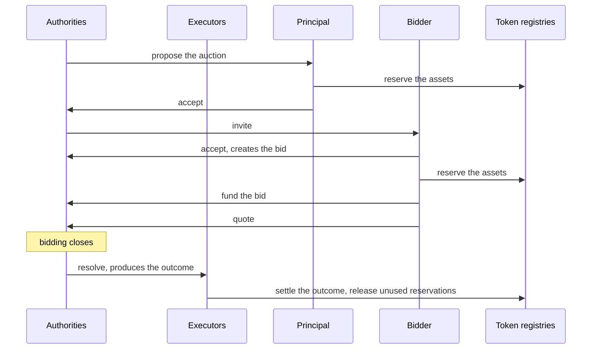
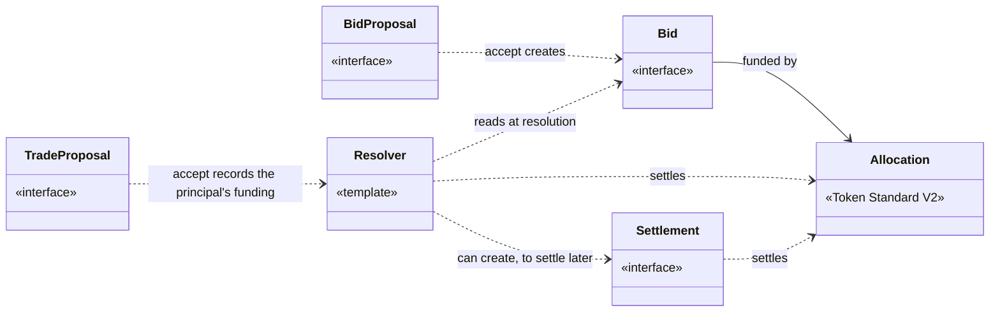

<!-- SPDX-License-Identifier: Apache-2.0 -->

# cap-auctions

cap-auctions is a Daml library for building auctions that settle with the
Canton Token Standard V2. It is intended for developers who need to implement
an auction format in Daml. The library provides interfaces and helpers. The
interfaces define a standard for auctions on Canton, so wallets and apps
written against them work with any auction format that implements them.

Canton has no auction library today, only proposals and early designs.

This document has five sections:

- [Section 1](#1-auctions) describes what an auction is, defines the terms
  used in the rest of the document, and lists the types of auctions.
- [Section 2](#2-token-standard-v2) describes why an auction
  needs the Token Standard V2 and what it brings.
- [Section 3](#3-how-an-auction-runs-in-daml) describes how an auction runs in
  Daml at a high level.
- [Section 4](#4-cap-auctions-architecture-overview) shows how the library's
  interfaces map to an auction.
- [Section 5](#5-library-contents) lists what the library contains.

[trust.md](trust.md) explains why the principal and the bidders trust the
executors, and how that trust can be reduced.

## 1. Auctions

An auction is a trade where several bidders compete to trade a lot with one
party. A mechanism decides which bids win and at what price, and the assets
then move between that party and the winners.

### 1.1. Terms

- *Principal*: The party the bidders trade with. It sells the lot in a forward
  auction and buys it in a reverse auction.
- *Bidder*: A party that submits a bid.
- *Lot*: The asset being traded, with the supply on offer and a reserve price.
- *Bid*: A bidder's participation in the auction. It holds the bidder's
  quotes and funding.
- *Quote*: A price per unit of the lot at which the bidder is willing to trade
  a certain amount of the lot.
- *Mechanism*: The rule that decides which quotes win, how much of the lot
  each winning quote trades and at what price.
- *Funding*: The assets a party reserves for the auction through the Token
  Standard, so that they can move at settlement.
- *Authorities*: The parties that run the auction. They propose it to the
  principal and the bidders, and resolve it.
- *Executors*: The parties that settle the auction. Every allocation of the
  auction names them. They can be the authorities or another set of parties
  (see [trust.md](trust.md)).
- *Resolver*: The contract that computes the outcome. It can be created for
  one auction, or be a standing contract that resolves many auctions.
- *Resolution*: The step that collects the bids, checks them, runs the
  mechanism and produces the transfers of the outcome.
- *Settlement*: The step that moves the assets. It can happen in the same
  transaction as the resolution.

### 1.2. Types of auctions

Auctions differ along several dimensions:

- Direction. In a forward auction the principal sells the lot and the highest
  quotes win. In a reverse auction the principal buys the lot and the lowest
  quotes win. cap-auctions uses the same interfaces for both directions.
- Bidding format. In a sealed-bid auction each bidder submits its quotes once
  and no bidder sees the other quotes. In a clock auction the price moves over
  time and bidders quote at the current price. In a Dutch auction the price
  falls until the quotes claim the whole supply. In an English auction the
  price rises until the quoted amounts no longer exceed the supply.
- Pricing rule. In a pay-as-bid (first-price) auction each winning quote
  trades at its own price. In a uniform-price auction every winning quote
  trades at the same clearing price, the price of the worst winning quote. In
  a Vickrey auction each winner's price is set by the value its winning quotes
  take from the other bidders.
- Lots and quantities. An auction can trade one item, a divisible quantity of
  one asset, or several lots at once. A quote can ask for part of the supply.
- Reserve price. Quotes below the reserve price (above it, in a reverse
  auction) do not win.

Every auction has the same base:

- terms that the principal and the bidders agree to before bidding starts;
- bids that each reserve the assets the bidder may have to send;
- a mechanism that turns the quotes into an outcome (who receives what, at what price);
- a settlement that moves the assets according to the outcome.

## 2. Token Standard V2

The Canton Network Token Standard V2 (CIP-0112) provides the interfaces for the allocation and
settlement logic, so an auction works with any token that implements the
standard. The lot and the payment are
tokens held at token registries, often at different ones. 

An allocation reserves a party's assets for one settlement. The party
approves the reservation before the outcome is known, and the executors decide
at settlement which transfers it covers, up to the reserved amount. A
settlement moves the assets of several allocations in one transaction, even
across registries, and releases what the transfers do not use.

## 3. How an auction runs in Daml

The authorities run the auction: they propose it, invite the bidders, see the
bids and resolve the auction. The executors settle it: every allocation of the
auction names them, and only they can settle or cancel it. The two roles can
be held by the same parties or by different ones.

## 4. cap-auctions architecture overview

The library defines an interface for each contract that wallets and apps need
to read or act on: the proposal to the principal, the invitation to a bidder,
the bid, and the settlement. The format author writes the templates that
implement them, and the resolver. The library also provides helpers for
checking bids, awarding the lot, pricing the awards and settling them through
the Token Standard.

The diagram shows an auction with a single trusted authority and executor.
With decentralized authorities or executors the contracts are the same and
each role is held by several parties or a decentralized party, as described
in [trust.md](trust.md#31-a-decentralized-party-as-executor).

The examples in [`examples/auctions`](../../examples/auctions) show a
sealed-bid and a Dutch single-lot auction.

## 5. Library contents

The library has three parts.

Interfaces, one for each contract that wallets and apps need to read or act
on:

- `TradeProposal`: the proposal of an auction to the principal, which the
  principal accepts with its funding.
- `BidProposal` and `Bid`: the invitation to a bidder, and the bid it
  creates, which the bidder funds and withdraws.
- `SingleLotQuotesBid`: a bid that holds quotes for one lot.
- `Settlement`: an outcome that is settled in a later transaction than the
  resolution.

Types for the terms of an auction: its lots, schedule, quotes and fundings.

Helpers:

- `Funding`: checks on bids and allocations, at submission or at resolution,
  and settlement of the outcome through the Token Standard, one batch per
  registry, with the unused allocations cancelled.
- `Clearing`: awards the supply of a lot to the quotes, best price first.
- `SingleLot`: pricing rules (pay-as-bid, uniform price, Vickrey) and the
  clearing and settlement of an auction with one lot.
- `Clock`: the price clocks of Dutch and English auctions.

The settlement helpers assume that the executors are trusted. They use
allocations with empty leg transfers, which the executors settle. The executors can be a decentralized party. [trust.md](trust.md) explains why this trust is
needed and how it can be reduced.
