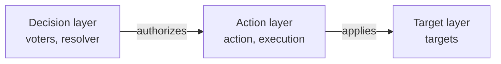
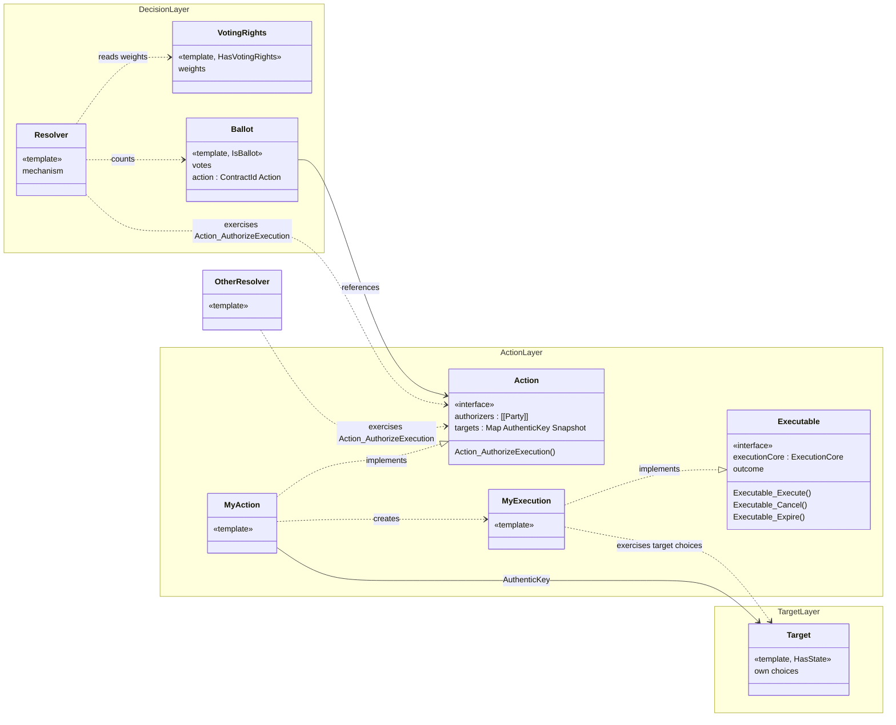

<!-- SPDX-License-Identifier: Apache-2.0 -->

# cap-governance

cap-governance is a Daml library for building governance flows. It is intended
for developers who need to implement a governance flow in Daml (in the sense
of [Section 2](#2-governance-flows-in-canton)).
The library supports both the design of the smart contract architecture and its
implementation in code. It does not define a standard, Canton does not
yet have enough governance use cases to derive one.

This document has four sections:

- [Section 1](#1-governance-in-the-canton-network) describes how the Global
  Synchronizer and Canton Coin are governed today and what other governance
  flows may need.
- [Section 2](#2-governance-flows-in-canton) defines
  the terms used in the rest of the document (voter, resolver, ballot, action,
  target, execution) and describes governance flows in canton at a high level.
- [Section 3](#3-cap-governance-architecture-overview) shows how the library's
  templates and interfaces map to canton governance flows.
- [Section 4](#4-what-do-we-need-to-worry-about-with-governance-in-the-canton-ledger-model-)
  lists some guarantees a governance flow must provide.

[rationale.md](rationale.md) explains the design decisions.

## 1. Governance in the canton network

When a change to a DAML contract depends on the agreement of several parties, they must agree on what the change is before it takes effect, and they need the ledger to record that agreement and enforce it. The parties must also agree in advance on how a decision is made (e.g. who may vote, how much each vote weighs, what mechanism will be used to decide the change). The ledger must enforce these rules as well.

### 1.1. What has already been done
The Global Synchronizer of the network and its native token, Canton Coin, are governed by a set of parties, the Super Validators (SVs). The governance flow works through a decentralized party, called DSO. A decentralized party is a party hosted in several participant nodes ideally operated by different identities. Any transaction in which the decentralized party is a stakeholder must be confirmed by at least k of its n hosting nodes.

The DSO is a signatory on the contracts that the SVs may change by agreement. We call these contracts *targets*, and we call a change on them an *action*. An action is applied by exercising a choice on the target with the DSO's authority. An agreement is reached through a mechanism. In the DSO, at least two thirds of the SVs must accept an action before its deadline, other rules are possible (e.g. majority voting, unanimity or weighted votes). Importantly, these mechanisms do not add extra security to the k-out-of-n threshold of a decentralized party (because if k participants collude they can act on behalf of the decentralized party). The contract that enables this agreement is also signed by the DSO, and we call it a *Resolver*. To reach an agreement, the SVs submit "input" to the resolver contract. Each input contains the action, the target it applies to and sometimes the new value to update. Once the agreement is reached, a choice on the resolver exercises the action's choice on the target.

### 1.2. What can be needed in the future
The governance of the Global Synchronizer and Canton Coin is one example of a governance flow in the Canton ledger model. Other flows will have requirements that this one does not. All of these flows nevertheless share a common base:

- a set of targets and the actions that change them.
- a resolver that receives the voters' input and runs the mechanism.
- the authority to apply an action to its targets once the rule is met.

Other examples of governance flows can have:

1. **Different mechanisms.** The decision may require a different
   participation threshold or a different way of combining the votes. Examples include a simple majority, unanimity, the option with the most votes, or the median of the values the voters submit.
2. **A vote based on rights.** The right to vote, and the weight of each vote,
   come from contracts the voters hold. For example, the voters may be the
   owners of an asset, each voting with a weight proportional to their holding.
3. **Time-locked execution.** An approved action can be executed only after a
   set time.
4. **Several resolvers for the same action.** The same action can be
   authorized by some party to more than one resolver contract (authorities). For example, a change may be approved either by a regular vote or by an emergency committee.

## 2. Governance flows in Canton
In this section, we introduce the common base for any governance flow in canton. To do it, it will be useful to define some terminology.

The voters submit "many things" to the resolver, it is useful to find a term for each. We will call *Ballot* to everything that is submitted, this includes for example, the action, the target(s) it applies to and the new value. We then define other two types of "input", the *vote* which is what the mechanism counts (e.g. option A, B or C, proposed fee). And the *parameters*, which is what the action applies to the targets (e.g. a new fee value) the parameters can come from the output of the mechanism (the *outcome*), (e.g. set fee to the median of all votes) or they could be already defined by the action (e.g reduce fee by 2%).

We write again what we already defined in the section above:
- *Voter*: A party allowed to submit a ballot to a resolver (in the canton network governance, the SVs).
- *Resolver*: A contract, where the voters' vote is collected, an outcome is decided and authority is collected.
- *Resolution*: The final step on running mechanism. That is, submitting the transaction that will compute mechanism and produce an *Executable*. The executable might be consumed in the same transaction that is created. 
- *Target*: A contract that will be changed by the governance flow, specifically by an action.
- *Action*: A predefined change to one or more targets.
- *Execution*: The final step on applying an action. That is, submitting the transaction that will change the state of the target.

### 2.1. The layers of a governance flow

We divide a governance flow into three layers. The decision layer contains
everything that determines how a decision is made. The action layer contains
everything that determines what changes and how the change is applied. The
target layer contains the contracts where the change takes effect. 

| Layer | Contains |
|---|---|
| Decision layer | voters, voting rights, ballots, votes, the resolver, its mechanisms and the outcome |
| Action layer | the action, with its targets, its parameters and the parties that may authorize it; the conditions of execution (when and by whom); the execution |
| Target layer | the targets and the choices that change them |

The layers connect at two points:

- **Decision layer to action layer.** Once a mechanism reaches an
  outcome, the resolver authorizes one action depending on the outcome. The decision layer depends on the action only through this authorization.
- **Action layer to target layer.** The execution exercises the target's own
  choices. The target layer does not depend on the governance flow.

### 2.2. Why do we bother with the three layers
Each layer can be written and owned by a different party. The governing parties own the decision layer. The parties with authority over the targets, or the parties they delegate to, write the action layer. The target layer can exist before any governance flow is built on it.
The advantages are:
1. It is easier and faster to add targets and execution logic to already deployed governance flows
2. Authority comes from the target owner, not necessarily the same as the resolver signatories.
3. One action can work with different mechanisms.
4. It is easier to standardize governance flows in canton

## 3. CAP-Governance architecture overview

The cap-governance architecture is built around this separation argument. The architecture is shown in this image.

## 4. What do we need to worry about with governance in the canton ledger model ?

Essentially, we need to worry that we execute exactly the change that the voters agreed to.
For this we need at least these guarantees:

### 4.1. Admitting and counting votes
At resolution a party chooses which ballots to present to the
resolver. The resolver must check that:

- each ballot belongs to this resolver and refers to the same resolution;
- each ballot is counted once;
- each voter has the right to vote, and counts with the weight that their voting rights give them;
- each ballot is counted by the;
- all the ballots refer to the for the same action(s).

### 4.2. Authenticity of targets and voting rights
If a choice accepts a contract id and only checks its template, a party can present a copy that it
signed itself. This applies to every contract that a governance flow reads or acts on:

- A target, if the execution acts on the copy and the real target does not change.
- A voting right, a self-signed voting-right contract gives its creator voting
  power they do not have.
- A ballot, a vote can only be trusted by the parties that signed it.

### 4.3. State drift between the decision and the execution
Voters approve a change against the state of the target they see when they
vote. The target can change before the execution, for example because another
action is executed first or some other party intervened. For example, a target with a fee of 1%, and an action A that raises it to 2%. Before A is executed, an action B raises the fee to 3%.
If A is then executed, it lowers the fee from 3% to 2%, which was not intended.

