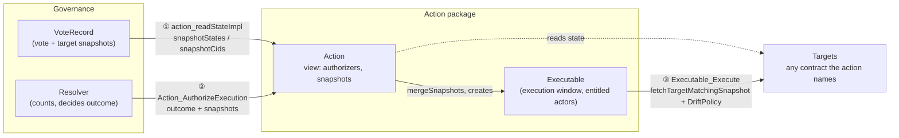

<!-- SPDX-License-Identifier: Apache-2.0 -->

# cap-governance rationale

This file explains the design decisions in cap-governance.

## Goal

The goal of cap-governance is to reduce the time it takes to build a governance
app on Canton. It provides the parts every governance app needs. Each part is
described below with the reason it is needed.

### Fetching and grouping vote records for resolution

The resolving party chooses which vote records to present, so the
choice that runs the mechanism must refuse a vote record for another resolution and a
vote record presented twice. `fetchGroup` fetches the vote records, refuses duplicates and
checks that each vote record references the same `ResolutionInfo`. `requireResolvedBy`
checks that the `ResolutionInfo` names the resolver where the outcome is decided
and the mechanism used.

**Example:** Two different governance flows with the same vote records templates, the group check
fails if contracts from one governance flow are used by a resolver on another governance flow.

### Checking the identity of the contracts a decision acts on

A target is a contract the execution needs to read or act on. An action names
each target by an `AuthenticKey`, which is the set of signatories plus an id. A
contract id by itself cannot prove who signed the contract. Any party can create
a contract of the same template with the same fields. `fetchCheckedAny` fetches
the presented contract and compares the key it computes from its own
signatories with the key the action names. `fetchWeightsPerKey` does the same check
for the contracts that carry voting rights.

**Example:** an action changes a parameter on a contract A signed by the operator.
An attacker creates a contract B of the same template, signed only by
themselves, and presents it as the target. Without the identity check, the
execution acts on the attacker's copy and contract A never changes, even though
the action counts as executed. The same risk applies to voting rights: a
self-signed voting-right contract would give its creator voting power they
don't have.

### Admitting votes

A vote counts only if its voter has the right to vote, has not voted already,
and voted for something the mechanism counts. A resolver passes the vote records
through `validVotes`, `fetchVoteRecords` and `validateDistinctIdentitiesAmong`,
and the voting rights through `validWeights`, before `casts` counts them. They
refuse:

- a voter who appears on two vote records;
- a voter with no weight;
- a negative weight;
- a vote that the mechanism's decoder does not accept.

**Example:** a vote record template carries votes of type `Approve | Reject | SetFee
Decimal`, and a yes/no mechanism counts only `Approve` and `Reject`. 

### Quorums and tallies

Every governance app decides two things: whether enough voters took part
(`Quorum`), and what the votes concluded (`Tally`). `decide` combines them into a
`Verdict`: `Lapsed` when the quorum fails, `Undecided` when the tally reaches
nothing, and `Decided` otherwise. They are kept separate because low turnout
and a split vote are different outcomes, and an app may handle them
differently. `Cap.Governance.Count` provides common quorums
(`atLeastPresent`, `atLeastVotes`, `atLeastVotedWeight`, `atLeastShareOfTotal`)
and tallies (`unanimous`, `plurality`, `shareOfVotes`, `median`,
`weightedMedian`), so an app builds its rule from these parts.

`Casts` holds one cast per eligible voter. Each cast's `vote` is `Absent`
when no vote was presented for the voter, `Abstained` when the voter took part
without choosing an option, or `Voted` with the option. Quorums can count
abstentions as turnout, and tallies only see `Voted`, because an abstention is
part of the turnout but not of the result.

**Example:** `decide (atLeastShareOfTotal 1 2) (shareOfVotes 2 3)` requires the
voters present, abstentions included, to hold half of the eligible voters' weight, and
one option to get at least two thirds of the weight of the votes. Shares are
given as a numerator and a denominator so that a share like two thirds is exact.

### Taking a snapshot of a target and checking it again at execution

A target can change between the vote and the execution, and voters approved the
change against the state they saw. A `Snapshot` records, per target, the state
or contract id the decision was made against. An action declares its `snapshots`
when it is created and can fix parts of their snapshots then. `snapshotStates`
and `snapshotCids` fill the parts the action left open with the target's current
state or contract id, and `mergeSnapshots` merges those snapshots into the
action's targets. At execution, `fetchTargetMatchingSnapshot` compares the target's live state
with the snapshot state using the action's
`DriftPolicy`. It refuses the execution if the target changed in a way the
policy does not allow.

**Example:** a target's fee is 1%, and voters approve action A to raise it to 2%.
Before A executes, action B raises the fee to 3%. If A then executes, it
lowers the fee from 3% to 2%, which nobody voted for. With a snapshot of the fee at 1%
and the `unchanged` policy, `fetchTargetMatchingSnapshot` sees that the fee is now 3% and
refuses A.

Other policies allow some changes. Take the same target with a fee of 1% and a
withdrawal limit of 10,000, and action A that raises the fee to 2%. The drift
policy `sameOn (.fee)` requires only the fee to be unchanged. If action B
lowers the withdrawal limit to 5,000, A still executes, because the fee is
still 1%. A drift policy only decides whether the execution goes ahead. To keep
B's change, A's execution must write only the fields A changes, for example
with Splice's `patch`, which applies the fields that differ between the new and
the snapshot state to the live state.

## When CAP uses an interface

CAP defines an interface only where we expect code to work with a contract
whose template it cannot know when it is compiled. Elsewhere it uses templates,
type classes and helper functions.

### Action and Executable

`Action` and `Executable` separate a governance app from the contracts it
changes. Through them, a decentralized party can govern contracts in other
packages or owned by other parties, without its package depending on theirs,
and one action contract can be used by several governance mechanisms.

`Action` is an interface because a resolver calls it on contracts written by
someone else. The owner of a target signs an action that names the
decentralized party in `authorizers`, and the resolver's choice that runs the
mechanism exercises `Action_AuthorizeExecution` on it. That choice is written without
knowing the action's package. The action's signatories don't have to be the
resolver's signatories, so a target owner can delegate authority over it to a
decentralized party.

`Executable` is an interface because it is what that call returns, and an
executor app can execute it without knowing the action's package.

The diagram shows how a governance app uses an action and its targets. The
governance app never reads or changes a target directly. It reads targets
through the action, and it holds their state only as `Snapshot`s.

1. When a vote record is cast or at resolution, the governance app reads the
   targets through `action_readStateImpl`, using `snapshotStates` or
   `snapshotCids`. The result is a `Snapshot` per target.
2. The resolver's choice that runs the mechanism exercises `Action_AuthorizeExecution` with the
   `outcome` (vote aggregation) and the snapshots. The action merges them into its own targets
   using `mergeSnapshots` and creates an `Executable`.
3. An entitled actor exercises `Executable_Execute` and presents the target
   contracts (`targetCids`). `fetchTargetMatchingSnapshot` compares each target's live state with its snapshot using
   the action's `DriftPolicy`, and the action then changes the targets.

### Vote records

`IsVoteRecord` in `Cap.Governance.Vote` lets the library work with any
vote record template. It gives the library a vote record's casts,
its snapshots, the action it asks to authorize, and how to consume it. An app writes
one instance per vote record template. The `VoteRecord` interface has one
instance in the library, so a resolver can count records of templates it does
not know.

### The vote record view

The `VoteRecord` interface lets software that does not know an app's templates
find an open decision, read what it decides and the votes cast on it. Its
callers are wallets and dApps (an SV voting from a CIP-0103 wallet, as in the SV
governance dApp CIP), indexers, and a decentralized party that is itself a
voter in another governance flow.

The two governance flows in Canton both have this shape. The DSO's
`VoteRequest` and the DRO's `GovernanceProposal` (the `.canton` naming CIP)
each have a requester, what is decided, a voting window, an optional effective
time, and votes by identities the governance knows. `VoteRecordView` holds
what they share:

- `resolution` names the resolver, the mechanism and the decision. The records
  of one decision share it, whether one record holds every vote or each voter
  has a record of its own.
- `options` lists the `ActionId` of each action the voters choose among.
- `voteBefore` and `effectiveAt` give the voting window and the execution time.
  `voteBefore` is `None` for a standing record.
- `votes` holds one `CastVote` per identity that voted: the vote, the acting
  party that cast it, its reason and its time.
- `targets` holds the snapshots of the contracts the options change.
- `consumers` names who archives the record once it is counted. A standing
  record has none.

The view carries no vote format: the mechanism name documents it (see "Vote
encoding" in [considerations.md](considerations.md)), and the resolver checks
every vote it counts.

The cost is that the view is frozen, so every vote record has to fit it.

### What a voter can trust

A voter sees the options as `ActionId`s and needs to know that the option it
votes for is the action that executes:

1. **The voter's participant computes the view.** It runs the template's code,
   and the Ledger API names the package in
   `InterfaceView.implementation_package_id`. A client shows a record only if
   that package is one the voter trusts and the record is signed by
   `resolution.resolver.authorities`.
2. **The view computes each `ActionId` from the action.** The template stores
   the typed action, or the `Action` contract it read the id from when the
   record was created. No id is text that the requester supplied.
3. **The vote names an `ActionId`.** An `ActionId` is injective, so a vote for
   one option is not a vote for another.
4. **Execution checks the id again.** The resolver requires that the action it
   executes has the id of the winning option, and checks the targets against
   their snapshots.
