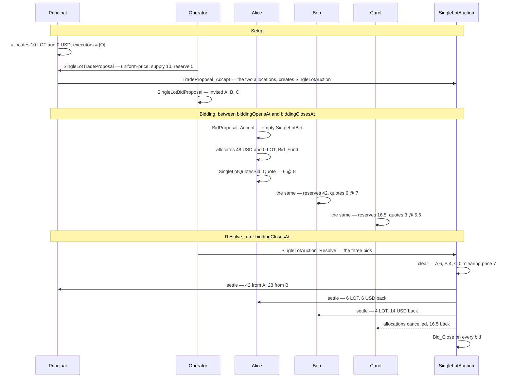
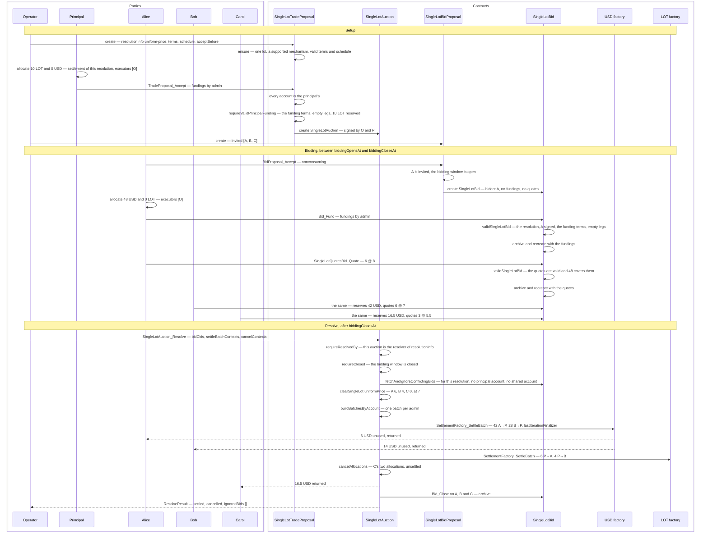
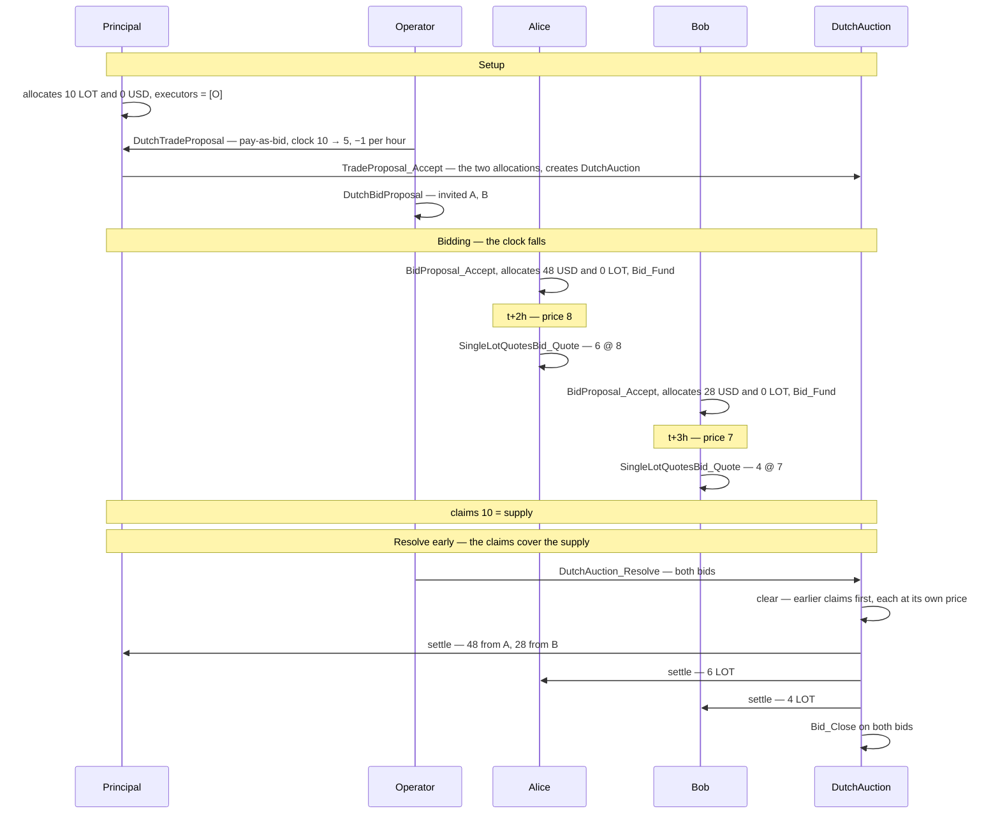
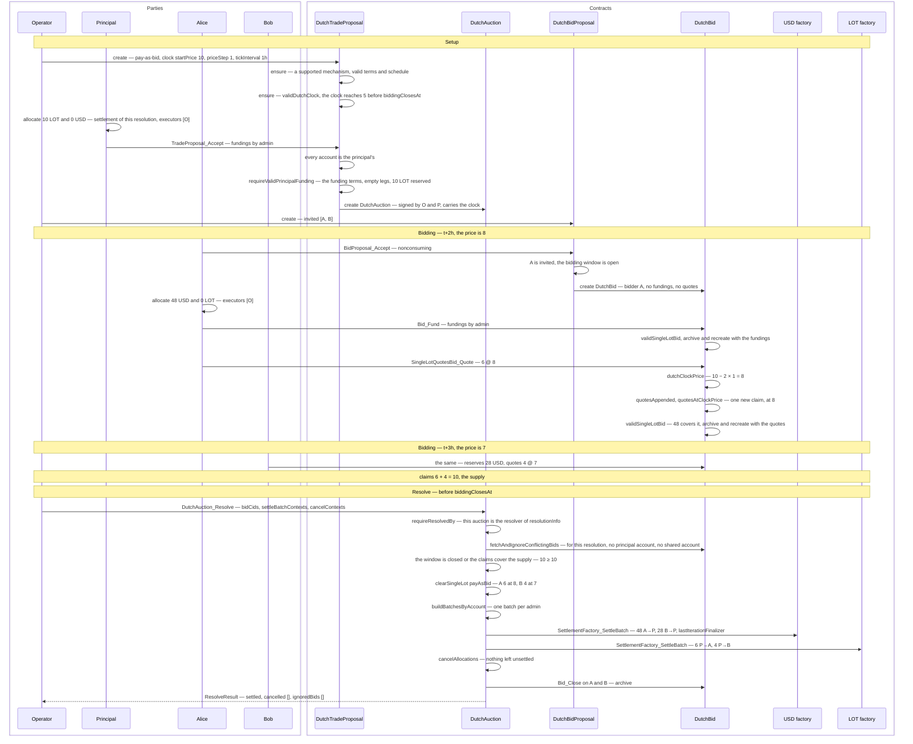

# Sequence diagrams — `examples/auctions`

These diagrams show the happy path of the two auction examples:
`sealed-single-lot` and `dutch-single-lot`. Each example has a short version
with the main steps and a long version that follows one auction choice by
choice. Failure paths and the checks that reject them are not shown.

Parties and contracts are both drawn as participants. An arrow from a party is a
command that party submits. An arrow from a contract is a choice exercised or a
contract created inside that command's transaction.

Both happy paths run as Daml Script in
`demo/daml/Cap/Examples/Auctions/Demo.daml`: `sealedSingleLotUniformPrice`
and `dutchSingleLotPayAsBid`. They use the registries and allocation helpers
of `cap-auctions/tests/ledger`, where LOT and USD are two test-token
registries and every party starts with 100 LOT and 1000 USD.

Both examples run a forward auction of one lot: the principal sells 10 LOT
at a reserve price of 5 USD per unit, in steps of 1. The operator is the sole
authority and the sole executor. LOT and USD have different admins, so
every resolution settles two batches, one per admin, in one transaction.

Every party funds the auction with one allocation under each admin. An
allocation reserves an amount and has no transfer legs. The legs are added at
settlement, and the registry returns whatever the legs do not use. A party
allocates 0 under the admin it only receives from.

## Sealed single lot

`sealed-single-lot` runs a sealed-bid auction under the uniform-price rule. Each
bidder funds and quotes once, and no bidder reads another bidder's bid. After
`biddingClosesAt`, the operator presents every bid to
`SingleLotAuction_Resolve`, which clears the lot and settles it in the same
transaction.

Alice quotes 6 at 8, Bob 6 at 7 and Carol 3 at 5.5. Alice is filled in full and
Bob for the 4 that remain. Carol is not filled. Both winners pay 7, the price of
the worst winning quote.

### Short version

### Long version

The long version adds the checks at each submission, how the resolution keeps
the bids, and how the outcome is grouped into batches and settled.

## Dutch single lot

`dutch-single-lot` runs a Dutch clock auction under the pay-as-bid rule. The
price starts at 10 and falls by 1 every hour until it reaches the reserve price.
A bidder quotes at the current price, so an earlier quote has a higher price
and is filled first. The operator can resolve as soon as the quotes claim the
whole supply, without waiting for `biddingClosesAt`.

Alice claims 6 at hour 2, at a price of 8. Bob claims 4 at hour 3, at a price
of 7. The claims then cover the supply, so the operator resolves. Each bidder
pays its own price.

### Short version

### Long version

The long version adds the checks on the clock, the check that each quote is at
the clock price, and the early-resolution condition.

